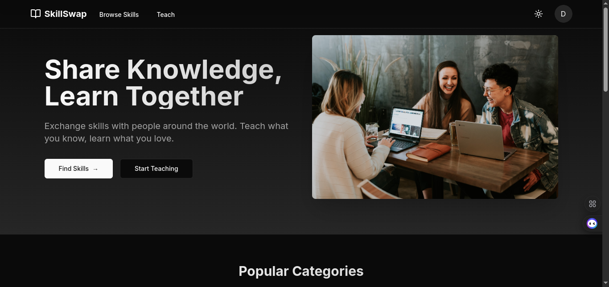
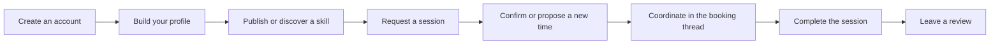

<div align="center">

# SkillSwap

### Share what you know. Learn what you love.

An online community for people to teach skills, discover learning partners, and coordinate one-to-one sessions.

[](https://github.com/Deviskalo/skill-exchange-platform/stargazers)
[](https://github.com/Deviskalo/skill-exchange-platform/network/members)
[](https://github.com/Deviskalo/skill-exchange-platform/graphs/contributors)
[](https://github.com/Deviskalo/skill-exchange-platform/issues)
[](LICENSE)

[Explore the app](#-what-is-skillswap) · [Features](#-features) · [Roadmap](ROADMAP.md) · [Contributing](CONTRIBUTING.md) · [Changelog](CHANGELOG.md)



</div>

## Contents

- [What is SkillSwap?](#-what-is-skillswap)
- [How an exchange works](#-how-an-exchange-works)
- [Features](#-features)
- [Technology](#-technology)
- [Project status](#-project-status)
- [Get started](#-get-started)
- [Environment variables](#-environment-variables)
- [Database and sample data](#-database-and-sample-data)
- [Quality checks](#-quality-checks)
- [Contributing](#-contributing)
- [Roadmap](#-roadmap)
- [Changelog](#-changelog)
- [Security and privacy](#-security-and-privacy)
- [License and acknowledgments](#-license-and-acknowledgments)

## 🌱 What is SkillSwap?

SkillSwap is a skill-sharing platform built around peer-to-peer learning. Members can create profiles, offer skills, find topics they want to learn, and request sessions with other members. Booking conversations help participants coordinate, while reviews and listing reports provide basic trust and safety tools.

The application is built with Next.js App Router. Database-backed pages use server components where appropriate, and authenticated changes go through server routes that validate the session and request.

## 🔄 How an exchange works



Sessions are scheduled as one-hour bookings. The requested time zone is stored with the booking so participants can see the intended local context.

## ✨ Features

### Accounts and profiles

- Email/password registration and sign-in, plus Google and GitHub sign-in providers.
- Server-created Firebase session cookies for authenticated server requests.
- Firebase identity synchronization with the MongoDB user record.
- Profile name, biography, learning interests, and avatar management.
- Avatar files are size-limited and stored as data URLs in MongoDB; Firebase Storage is not required.
- Password changes are handled through Firebase Authentication and require reauthentication.

### Skill discovery and listings

- Create, edit, view, and browse skill listings.
- Organize listings by category and tags.
- Search and filter listings in the browse view.
- Home page sections for popular categories, recent listings, and top contributors.
- Authenticated listing changes are handled by server endpoints, with ownership checks for edits.

### Booking and coordination

- Request a one-hour session with a skill provider at a future date and time.
- Validate time zones, prevent booking your own listing, and check for conflicting confirmed sessions.
- Limit repeated booking requests and prevent duplicate active requests for the same skill.
- Teachers can confirm or decline pending requests; participants can cancel eligible bookings.
- Participants can propose, accept, or decline a new time for an upcoming confirmed session.
- Booking conversation threads are available to the booking participants.
- Teachers can mark a confirmed session complete after its scheduled end time.
- Learners can review completed sessions.
- Dashboard overview of offered skills, bookings, and booking actions that need attention.

### Trust and safety

- Members can report skill listings, with duplicate and per-day report limits.
- Moderators can review reports and update their status.
- Moderator access is controlled by the `MODERATOR_EMAILS` environment variable.
- Server endpoints validate participant access and action permissions for booking and report operations.

### Supporting pages

The app also includes informational pages for how it works, help, contact, safety, privacy, cookies, and terms.

## 🧰 Technology

| Area | Technology |
| --- | --- |
| Web framework | Next.js 14 App Router |
| UI | React 18, Tailwind CSS, shadcn/ui and Radix UI |
| Identity | Firebase Authentication and Firebase Admin |
| Database access | Prisma ORM |
| Database | MongoDB |
| Validation | Zod |
| Forms | React Hook Form |

## 📍 Project status

**Current stage: feature-complete foundation; integration and real-world validation remain.**

The repository contains the main user journey—accounts, profiles, listings, booking lifecycle, coordination, reviews, and report moderation. A production build and TypeScript check have passed in the current development environment. That verifies compilation and type correctness, but does **not** establish that the entire product has been exercised against a live Firebase project and MongoDB database with multiple users.

See the [project roadmap](ROADMAP.md) for what is complete, what should happen next, and longer-term ideas.

## 🚀 Get started

### Requirements

- Node.js and npm
- A MongoDB database (for example, MongoDB Atlas)
- A Firebase project with Authentication providers configured
- Firebase Admin service-account values for server-side session verification

### Install and configure

```bash
git clone https://github.com/Deviskalo/skill-exchange-platform.git
cd skill-exchange-platform
npm install
```

Create `.env.local` at the repository root and add the variables listed in [Environment variables](#-environment-variables). Do not commit this file.

Generate the Prisma client and synchronize the MongoDB schema:

```bash
npx prisma generate
npx prisma db push
```

Start the development server:

```bash
npm run dev
```

Open [http://localhost:3000](http://localhost:3000).

## 🔐 Environment variables

| Variable | Required | Purpose |
| --- | --- | --- |
| `DATABASE_URL` | Yes | MongoDB connection string. Include a database name in the URI path. |
| `NEXT_PUBLIC_FIREBASE_API_KEY` | Yes | Firebase web app configuration. |
| `NEXT_PUBLIC_FIREBASE_AUTH_DOMAIN` | Yes | Firebase web app configuration. |
| `NEXT_PUBLIC_FIREBASE_PROJECT_ID` | Yes | Firebase web app configuration. |
| `NEXT_PUBLIC_FIREBASE_STORAGE_BUCKET` | No | Firebase web app configuration; Firebase Storage is not used for avatars. |
| `NEXT_PUBLIC_FIREBASE_MESSAGING_SENDER_ID` | Yes | Firebase web app configuration. |
| `NEXT_PUBLIC_FIREBASE_APP_ID` | Yes | Firebase web app configuration. |
| `FIREBASE_PROJECT_ID` | Yes | Firebase Admin service account project ID. |
| `FIREBASE_CLIENT_EMAIL` | Yes | Firebase Admin service account client email. |
| `FIREBASE_PRIVATE_KEY` | Yes | Firebase Admin service account private key. Preserve newlines as `\n` in env files. |
| `MODERATOR_EMAILS` | No | Comma-separated email allowlist for report moderation. |

Use `.env.example` as a template. Keep Firebase Admin credentials server-only; never prefix them with `NEXT_PUBLIC_` or commit populated environment files. For profile images, the app stores small data URLs in MongoDB and limits uploads to 1 MB; this avoids requiring a paid Firebase Storage plan.

## 🗃️ Database and sample data

The Prisma schema is in [`prisma/schema.prisma`](prisma/schema.prisma). After configuring `DATABASE_URL`, initialize the schema with:

```bash
npx prisma generate
npx prisma db push
```

The repository includes a Prisma seed script. To load its sample data:

```bash
npx prisma db seed
```

Prisma commands must run in an environment where `DATABASE_URL` is available. The seed data is for development and should not be treated as production user content.

## ✅ Quality checks

Run the checks before submitting a change:

```bash
npx tsc --noEmit
npm run lint
npm run build
```

The project currently does not define an automated end-to-end test suite. See the [roadmap](ROADMAP.md) for the planned integration and journey validation work.

## 🤝 Contributing

Contributions, bug reports, and feature ideas are welcome. Please read [`CONTRIBUTING.md`](CONTRIBUTING.md) for the development workflow and pull request checklist.

## 🗺️ Roadmap

The roadmap separates implemented foundations from the validation work needed next and future product opportunities. View [`ROADMAP.md`](ROADMAP.md).

## 📝 Changelog

See [`CHANGELOG.md`](CHANGELOG.md) for notable project changes.

## 🛡️ Security and privacy

- Never commit credentials, `.env`, `.env.local`, service-account JSON, or private keys.
- Report security issues privately to the repository owner rather than publishing exploitable details in an issue.
- Profile avatars are stored in MongoDB as data URLs. Keep the upload size limit in mind when evaluating database document size.
- Firebase Authentication and Firebase Admin configuration are required for authenticated features.

## 📄 License and acknowledgments

This project is distributed under the MIT License. See [`LICENSE`](LICENSE).

Thanks to the projects and communities behind [Next.js](https://nextjs.org/), [React](https://react.dev/), [Firebase](https://firebase.google.com/), [MongoDB](https://www.mongodb.com/), [Prisma](https://www.prisma.io/), [Tailwind CSS](https://tailwindcss.com/), and [shadcn/ui](https://ui.shadcn.com/).

---

Built by [Dev Iskalo](https://github.com/Deviskalo) and contributors. If SkillSwap is useful to you, consider [starring the repository](https://github.com/Deviskalo/skill-exchange-platform/stargazers).
